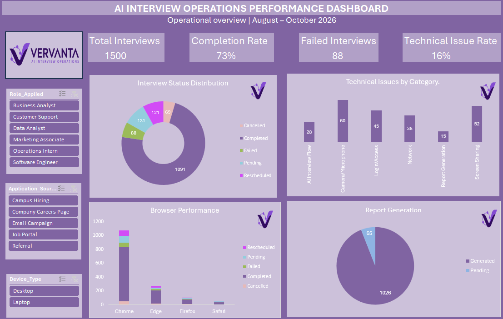

# AI Interview Operations Dashboard | Vervanta

An Excel-based operations analytics project focused on monitoring AI interview workflows, tracking interview outcomes, identifying technical issues, and evaluating report generation performance.

> **Note:** Vervanta is a fictional company created for this portfolio project. The dataset is synthetic and does not represent actual company records.

## 📊 Project Overview

This project simulates an AI interview platform's operational workflow. The objective is to analyze interview performance and identify areas where operational improvements could be made.

The dashboard provides an overview of interview completion, failures, technical issues, browser-wise outcomes, and report generation status.

## 🎯 Business Objectives

- Monitor interview completion and failure rates.
- Track interview statuses across the workflow.
- Identify the most frequently reported technical issues.
- Compare interview outcomes across different browsers.
- Monitor report generation for completed interviews.
- Support operational decision-making through an interactive dashboard.

## 🛠️ Tools & Skills

- **Microsoft Excel**
- PivotTables and PivotCharts
- Excel formulas and KPI calculations
- Data cleaning and data quality checks
- Interactive slicers
- Dashboard design and data visualization
- Operational reporting and analysis

## 📁 Project Files

| File | Description |
|---|---|
| `AI_Interview_Operations.xlsx` | Excel workbook containing the dataset, KPI calculations, PivotTables, and dashboard |
| `dashboard.png` | Screenshot of the completed operations dashboard |

## 📈 Dashboard Preview

## 📌 Key Performance Indicators

The dashboard tracks the following operational metrics:

| KPI | Result |
|---|---:|
| Total Interviews | 1,500 |
| Completed Interviews | 1,091 |
| Completion Rate | 72.7% |
| Failed Interviews | 88 |
| Failure Rate | 5.9% |
| Technical Issue Rate | Approximately 16% |
| Reports Generated | 1,026 |

## 🔍 Analysis Performed

### 1. Interview Status Analysis

Analyzed the distribution of interview statuses, including completed, pending, failed, rescheduled, and cancelled interviews.

### 2. Technical Issue Analysis

Examined technical issues by category to identify common operational challenges.

| Technical Issue Category | Count |
|---|---:|
| Camera/Microphone | 60 |
| Screen Sharing | 52 |
| Login/Access | 45 |
| Network | 38 |
| AI Interview Flow | 28 |
| Report Generation | 15 |

### 3. Browser Performance Analysis

Compared interview outcomes across Chrome, Edge, Firefox, and Safari to understand the distribution of interview statuses across browsers.

### 4. Report Generation Analysis

Analyzed report generation status for completed interviews.

- **1,026 reports generated**
- **65 reports pending**

This indicates that approximately 5.96% of completed interviews had reports pending generation in the simulated dataset.

## 💡 Key Insights

- The interview completion rate was approximately 72.7%.
- Camera and microphone issues were the most frequently reported technical issue category.
- Screen-sharing and login/access issues were also notable operational challenges.
- 65 completed interviews had pending reports, highlighting a potential report-generation follow-up requirement.
- Browser-wise outcome comparisons can help identify areas for further investigation, although differences do not establish that a browser caused an issue.

## 🧹 Data Preparation

The dataset was reviewed for:

- Missing values
- Duplicate records
- Interview status consistency
- Technical issue categories
- Report status consistency

The dataset contains 1,500 simulated interview records covering August–October 2026.

## 📂 Workbook Structure

- **Interview_Data:** Raw synthetic interview records
- **Data_Dictionary:** Column definitions
- **KPI_Calculations:** Formula-based operational metrics
- **Pivot_Analysis:** PivotTable-based analysis
- **Operations_Dashboard:** Interactive dashboard with KPI cards, charts, and slicers

## 🚀 Recommendations

Based on the simulated analysis:

1. Prioritize camera/microphone and screen-sharing troubleshooting.
2. Review the report-generation workflow to reduce pending reports.
3. Monitor interview failures and technical issues regularly.
4. Investigate browser-wise differences using larger datasets and additional context.
5. Use operational dashboards to support routine monitoring and follow-up.

## 📚 Learning Outcomes

Through this project, I practiced:

- Structuring and validating operational data
- Calculating KPIs using Excel formulas
- Building PivotTables and PivotCharts
- Designing an interactive Excel dashboard
- Translating operational data into actionable insights
- Presenting findings in a business-focused format

## 👩‍💻 Author

**Sneha Nainani**

Aspiring Data Analyst | Excel | SQL | Power BI | Tableau

